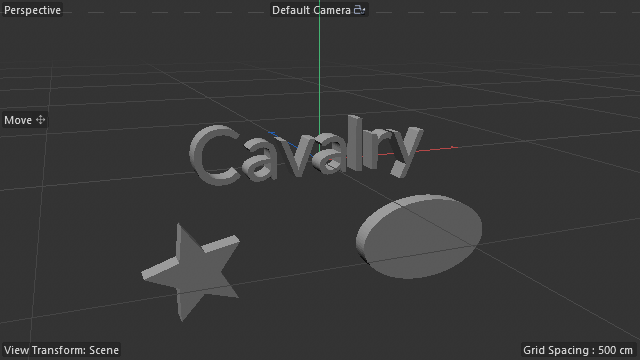

<p align="center"></p>

<h1 align="center">Cavalry Bridge</h1>

<p align="center">A live link between <b>Cavalry</b> and <b>Cinema&nbsp;4D</b>.<br>
Send Cavalry shapes, with their animation, to Cinema&nbsp;4D as real splines. Stream Cinema&nbsp;4D splines into Cavalry as you edit them.</p>

<p align="center">
  <a href="../../releases/latest"><b>Download for Windows</b></a> ·
  <a href="https://sakabatou.github.io/cavalry-bridge/">Project page</a>
</p>

<p align="center"></p>

## Features

| Direction | What happens |
|---|---|
| **Cavalry → Cinema 4D** | *Send Selected to C4D* creates **Cavalry Splines**, real spline objects that work directly in Extrude, Sweep, Loft and Lathe. Holes in letters stay holes, the shapes are saved with the scene, and the Scale tool resizes them like any primitive. |
| **…as a group or one object** | *Send as: Group* rebuilds your **folders as Nulls**, each shape its own Cavalry Spline with its position, rotation, scale and pivot. *Send as: Single object* merges everything into one spline. |
| **…with animation** | With *Animation (PSR)* ticked, layers and folders bring their position, rotation and scale **keyframes**. Eases are rebuilt as curve handles on the original keys. |
| **Cinema 4D → Cavalry** | Splines, **3D objects** and **whole folders** sent from the Cavalry Bridge panel appear in Cavalry as **editable shapes inside matching groups**, following every change (renames, moves, hiding) live, seen through the C4D camera or in world XY. 3D objects arrive as their outline, holes included. Tick **Animation** to key every frame of the preview range instead, one layer per object. |

The Cavalry window **connects by itself** whenever Cinema 4D is running, and only does work when something changes. Everything stays on your own computer: a state file in your temp folder, and `127.0.0.1:1234` for sending shapes to C4D.

## Install

1. Download `CavalryBridgeSetup-x.y.z.exe` from the [latest release](../../releases/latest) and run it.
   It finds each Cinema 4D version (R23 or newer) that has been started at least once, and Cavalry, then installs into their user folders. No admin rights are needed.
2. Restart Cinema 4D.
3. In Cavalry, open **Window › Scripts › C4D Bridge**. The first time, Cavalry asks whether to trust the script, because it makes local network calls. **Choose to trust it**, or it can't connect.

If Windows shows "Windows protected your PC" (the setup isn't code-signed yet), click **More info › Run anyway**.

| App | Installed into |
|---|---|
| Cinema 4D | `%APPDATA%\Maxon\<version>\plugins\cavalry_bridge\` (opened from **Extensions › Cavalry Bridge**) |
| Cavalry | `%APPDATA%\Cavalry\Scripts\C4D Bridge.js` |

## Use

**Cavalry → Cinema 4D:** select layers or groups in Cavalry, choose *Send as* (Group or Single object), optionally tick *Animation (PSR)*, then click **Send Selected to C4D**.

**Cinema 4D → Cavalry:** open **Extensions › Cavalry Bridge**, select splines, 3D objects or folders (Nulls) and click **Send Selected to Cavalry**. Sending again replaces what's sent; Send with nothing selected stops. Tick *Animation* first to key every frame in Cavalry. The panel shows the connection, what's being sent and what Cavalry sent last; the C4D Bridge window in Cavalry connects by itself.

The [project page](https://sakabatou.github.io/cavalry-bridge/) explains every setting, how the bridge works, and how it was built.

## Build from source

Requires Windows and nothing else: it uses the .NET Framework 4.x C# compiler that comes with Windows.

```
powershell -ExecutionPolicy Bypass -File build_installer.ps1
```

This builds `dist\CavalryBridgeSetup-<version>.exe`, with every file it installs packed inside. The setup also runs from the command line with `/silent`, `/uninstall`, `/log <file>` and `/appdata <folder>`.

```
cavalry_bridge/            Cinema 4D plugin, one file: panel, Cavalry Spline, local server, keyframe fitting
C4D Bridge.js              Cavalry script window
installer/                 setup program source (C#), manifest, icon
build_installer.ps1        builds the setup .exe
docs/                      project page (GitHub Pages)
```

## Limits

- Only outlines transfer. Fills, gradients, stroke widths and effects don't, and strokes arrive as their centre line.
- 3D objects arrive as their flat silhouette, without inner edges or shading.
- Animation covers keyframed position, rotation and scale (with *Send as: Group*). Behaviour-driven motion (Noise, Oscillator) isn't included.
- If the two apps run at different frame rates, keyframes keep their timing in seconds, so they can land between frames.
- Windows only for now.
- Plugin IDs are registered with Maxon: **1071603** (Cavalry Spline), **1071604** (receiver) and **1072165** (panel). Scenes made with the 1.0.0 test-ID build won't load their Cavalry Splines in later versions; send the shapes again.

---

Cinema 4D is a trademark of Maxon. Cavalry is made by Scene Group / Canva. This project isn't affiliated with either.
